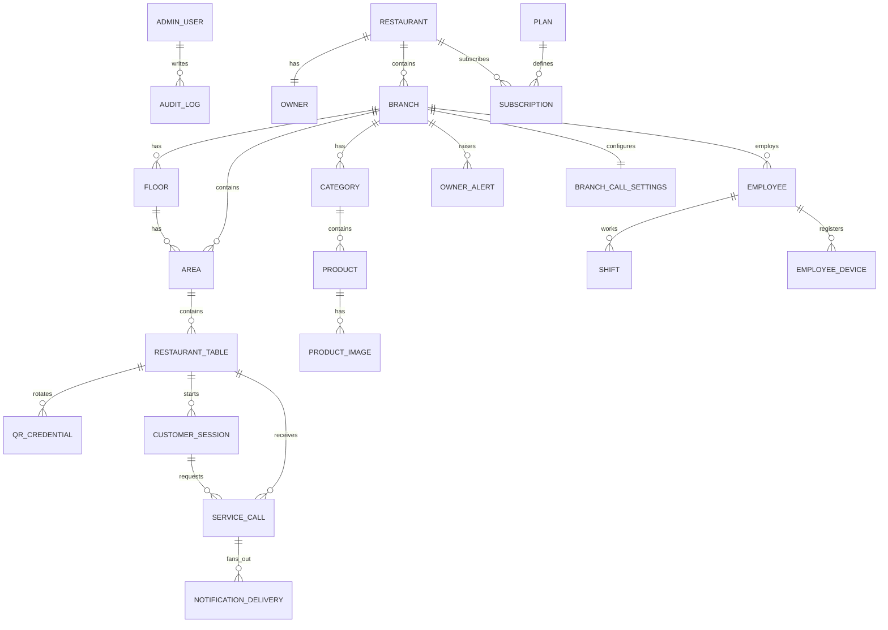

# ERD — logical draft

## Data integrity rules
- UUID PKs; tenant_id/restaurant_id scope on branch-owned tables, indexed foreign keys.
- Restaurant owner unique per restaurant; employee belongs to exactly one branch and department.
- QR credential opaque random token hash, only one active token per table, rotation revokes prior sessions.
- Product price integer minor units; currency explicit. No sensitive passwords in fixture or audit.
- Soft delete/archival for product, table, employee; historical calls preserved.
- Unique idempotency key per call scope; atomic cooldown enforced with transaction/lock or Redis atomic script.
- Shift auto-end configurable, active shift uniqueness per employee.
- Outbox entries written in same DB transaction as accepted service call.
- Tenant scope and subscription validation on every protected operation.
